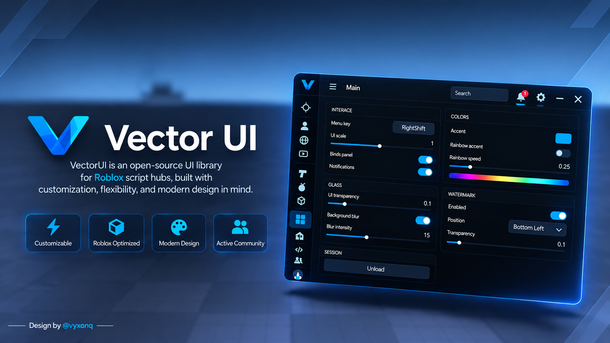
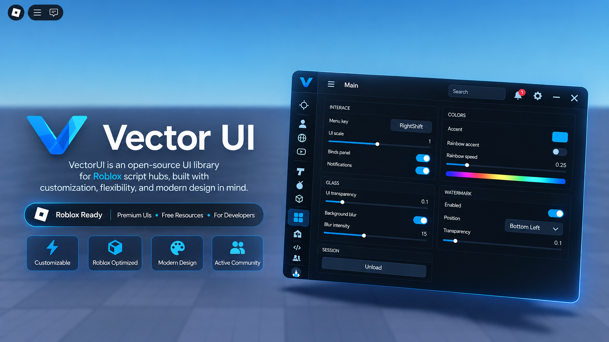

# VectorUI

VectorUI is an open-source UI library for Roblox script hubs, built with customization, flexibility, and modern design in mind.

**An open-source UI library for Roblox script hubs.**

VectorUI is a modern and customizable UI library designed for Roblox script hubs, focusing on clean aesthetics, flexibility, performance, and a smooth user experience.

<!--  -->



## Features

- **Modern Interface** | Clean, minimalistic, and polished design.
- **Customizable Themes** | Configure accent colors and interface appearance.
- **Smooth Animations** | Fluid transitions and interactive components.
- **Flexible Navigation** | Customizable navigation positioning and layouts.
- **UI Components** | Buttons, cards, sliders, dropdowns, inputs, and toggles.
- **Keybind System** | Configurable keybinds and interaction controls.
- **Notifications** | Integrated notification system.
- **Watermark** | Customizable positioning and appearance.
- **Glass Effects** | Adjustable transparency, background blur, and blur intensity.
- **Performance Optimized** | Designed with efficiency and responsiveness in mind.
- **Modular Architecture** | Flexible structure for extending and maintaining components.

## Community

Join our Discord server to follow development, receive updates, share feedback, report issues, and connect with other VectorUI users.

[**Join the VectorUI Discord Server**](discord.gg/PGy9yu2MY5)

## Preview

More screenshots and UI demonstrations will be added as development progresses.

## Documentation

Documentation, component references, and usage examples will be added in the future.

## Project Structure

```text
VectorUI/
├── docs/
│   ├── cover.png
│   └── cover2.png
├── src/
├── examples/
└── README.md
```

## Development Status

VectorUI is currently under active development. More components, customization options, performance improvements, and documentation are planned.

## License

This project is open source. License details will be provided upon release.

---

**VectorUI | Designed for flexibility.**